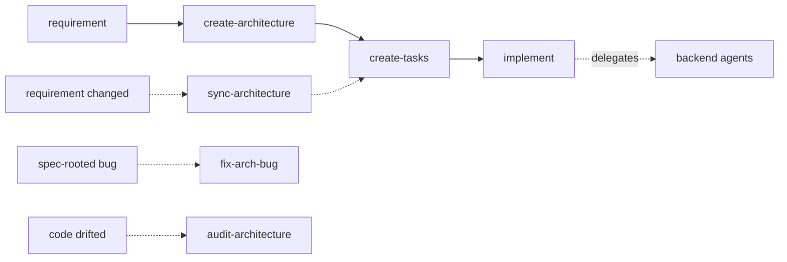

# architect

Spec in, buildable plan out. This plugin designs a feature's backend architecture against the code you
already have, slices it into ordered tasks, builds those tasks in parallel, and keeps the design honest
as requirements and code change.

Useful for anyone shaping a feature or MVP before implementation starts — architects, leads, senior
engineers.

```
/plugin install architect@toolkit
```

Requires `core`. Implementation is handed to the `backend` agents from the backend build plugins.

## Pipeline



Typical asks: "design this feature", "break it into tasks in the right order", "build them",
"the story changed — update the design".

## Commands

| Command | What it does |
|---|---|
| `/architect:create-architecture <spec>` | Feature architecture folder: small role-tagged blocks, specs centralised in `api-contract/` and `data-model/`. |
| `/architect:create-tasks <arch folder>` | Wave-ordered task briefs; contracts task first and alone; briefs link the docs. |
| `/architect:implement <next\|all\|N> [stacked]` | Builds tasks in parallel, isolated per task; full test gate and mandatory `review-changes` before any PR. `stacked` = one PR per wave. |
| `/architect:multi-epic <epics>` | Several backend epics side by side: readiness check, worktree per epic, collision hotspots, merge order. |
| `/architect:multi-epic-workflow <epics>` | The same, automated on the Workflow tool, with an adversarial contract review per epic. |
| `/architect:sync-architecture <change> [feature]` | Applies a requirement change to the docs and reports affected task briefs. |
| `/architect:fix-arch-bug <bug> [doc]` | One spec-rooted bug: backend fix, then docs, behind two approval gates. |
| `/architect:audit-architecture [feature]` | Docs-vs-code drift in both directions, with cheapest-first fixes. Mostly read-only. |
| `/architect:system-architecture [analyze]` | System-level document: context, ADRs, data, infra, security, integrations, observability. |
| `/architect:status [feature]` | Read-only: the stage each feature reached and the command that continues it. |

## Skills

Each command of the same name loads its skill.

| Skill | Core idea |
|---|---|
| `create-architecture` | One folder per feature; specs live once in shared files; blocks drafted by parallel agents; impact pass on overlapping features. |
| `create-tasks` | Contracts first; cohesive slices grouped into dependency waves; short briefs that link rather than copy. |
| `implement` | Branch + PR per task (or per wave when stacked), integration test gate, required review before PRs. |
| `multi-epic` | Parallel epics with readiness audit and gap-fill via the two skills above; FE/infra epics flagged for a human. |
| `sync-architecture` | Diff table first, surgical edits, change log, task impact. |
| `fix-arch-bug` | Backend then docs, local review file, two gates; consumers listed, never edited. |
| `audit-architecture` | Validator inventory vs real code, normalised comparison, evidence per finding. |
| `status` | Defines and reads the progress/worklog files. |

## Agent

`solution-architect` — pragmatic, codebase-first: ADRs, backend design, MVP breakdowns.

## Inputs and outputs

Specs come from a local file or pasted text and are never modified. Everything produced is local
Markdown in your repo for you to review. Shared architecture conventions can be kept in the
`claude-workspace` repo under `architecture/` and pulled with `/core:sync`.

[Toolkit home](../../README.md)
