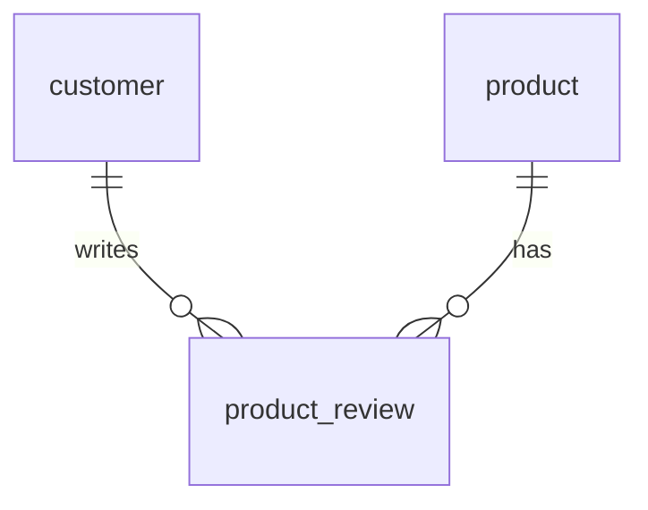

# Data model

| Entity (folder) | Table | Status | Owning domain |
|-----------------|-------|--------|---------------|
| Review (`apps/api/src/reviews/entities`) | `product_review` | proposed | [product-reviews](./product-reviews.md) |

