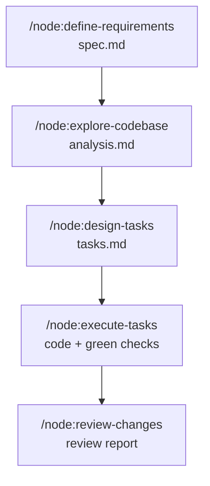

# node plugin

Workflows, skills and an agent for NestJS services. It takes a backend feature from a written
requirement through planning and implementation to a severity-ranked review, and adds smaller tools
for bug fixing, tests, e2e generation, Postman collections and file-structure hygiene. Project
specifics (data layer, paths, shared contracts package) are read from `.claude/toolkit.json`, so
nothing is tied to one repository.

## Install

```
/plugin install core@toolkit
/plugin install node@toolkit
```

Then in the project: `/core:setup`, `/node:setup`, `/core:sync`.

## Feature flow

Each step writes a file in `docs/specs/<feature>/` that the next step reads.



| Step | Produces | Key behaviour |
| --- | --- | --- |
| `define-requirements <feature>` | `spec.md` | stories, numbered requirements, endpoints, failure cases; waits for approval |
| `explore-codebase <feature>` | `analysis.md` | reference implementations and constraints, no solutions |
| `design-tasks <feature>` | `tasks.md` | end-to-end slices, contract work first |
| `execute-tasks <feature>` | code | one slice at a time; typecheck, lint, tests after each |
| `review-changes [branch]` | `docs/reviews/review-<branch>.md` | rule-cited findings, challenged before reporting; read-only |

## Other commands

| Command | Use it to |
| --- | --- |
| `/node:setup` | record the backend stack in `.claude/toolkit.json` |
| `/node:setup-project` | configure a starter-kit backend through environment settings |
| `/node:bugfix "<symptom>"` | find the cause, apply a minimal fix, add a regression test |
| `/node:test <target>` | add unit or integration tests in the project's style |
| `/node:generate-postman` | create or refresh a Postman collection and environments |
| `/node:actualize-structure [scope]` | align file names, constants and comments with the rules; moves only |

## Skills

| Skill | Covers |
| --- | --- |
| `nestjs-engineering` | modules, DI, request pipeline, validation, auth, testing, shutdown |
| `node-runtime` | event loop, async context, streams, workers, child processes, cancellation |
| `typescript-engineering` | type modelling, narrowing, generics, runtime validation |
| `backend-reliability` | idempotency, outbox, retries, queues, caching, concurrency |
| `database-engineering` | modelling, indexes, query plans, transactions, safe migrations |
| `generate-e2e` | API-level e2e tests modelled on the project's existing specs |
| `actualize-backend-structure` | the procedure behind `/node:actualize-structure` |

## Agent

`backend` — a NestJS engineer that defines the API contract before implementing it and follows the
synced backend rules.

## Rules

Backend standards live in this toolkit under `rules/backend/` and `rules/backend-node/`.
`/core:sync` copies them into `.claude/toolkit-rules/`, and the core hook injects the relevant ones
whenever a matching file is edited.
