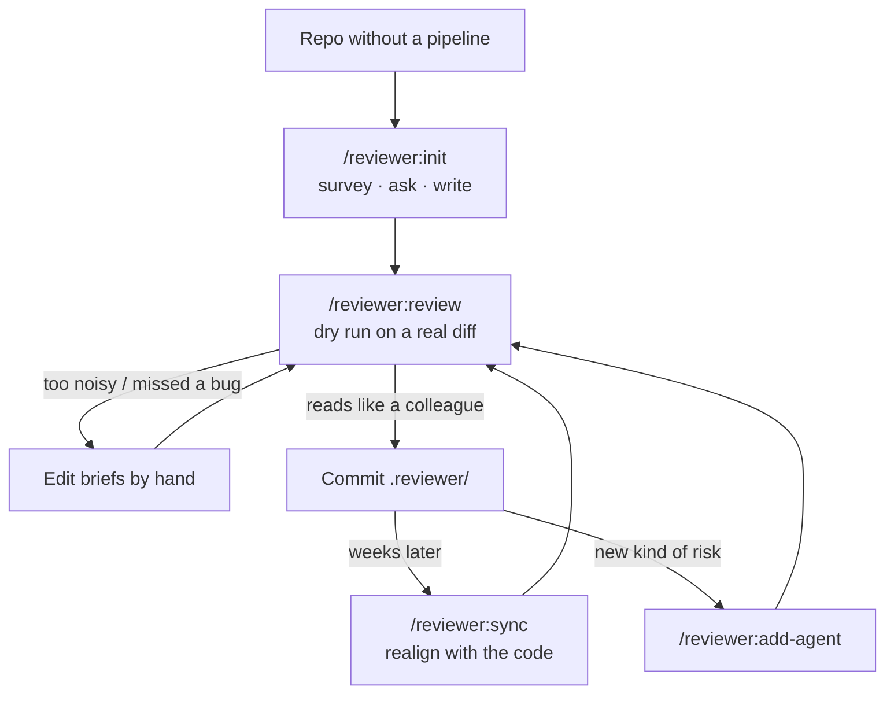
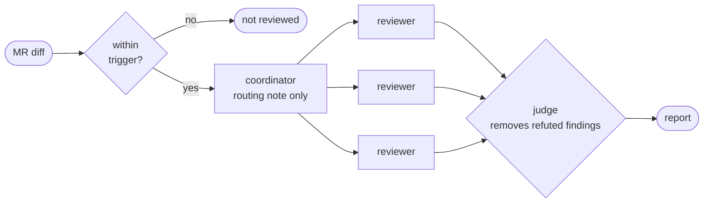

# reviewer — user guide

This guide covers creating `.reviewer/`, tuning it until its comments are worth reading, keeping it current
while the codebase evolves, and diagnosing a reviewer that produces noise.

---

## 1. Two ideas the plugin is built on

**Specific beats generic.** A reviewer that says "check error handling" teaches nothing. One that says
"`src/orders/totals.ts` is the only place allowed to round; rounding elsewhere drifts invoices by a cent"
gets read. Every generated brief names real files and real conventions from your repo.

**Wrong is worse than vague.** A brief that sends someone to a file that does not exist is still useless and
also proves nobody checked. So generation ends with a blocking gate: every path, symbol and convention a
brief mentions is verified on disk first.

And a practical consequence: **`.reviewer/` is versioned with the code.** The runner takes it from the MR's
source branch, so a review change ships in the same MR as the code that needed it, and anyone
can adjust a reviewer in the open.

---

## 2. Lifecycle



- Expect two or three review→edit loops before the first commit. An untried pipeline is a guess.
- Hand edits are the intended end state, not drift. `:sync` patches around them and never regenerates a
  brief wholesale.
- **CI.** The plugin ships the generator and the local runner, not a hosted service. Until a runner is wired
  up (mapping the `pipeline.yml` keys to its format), `:review` is the way the pipeline runs. Committing
  `.reviewer/` early still pays: it is versioned and reviewable.

---

## 3. Inside `/reviewer:init`

| Step | What happens | Writes? |
|---|---|---|
| 1 · Classify | New build or established codebase — decides whose rules reviewers enforce | no |
| 2 · Survey | Six read-only probes, each finding with evidence | no |
| 3 · Score | Catalog marked take / maybe / skip; discovered reviewers proposed | no |
| 4 · Decide | You answer up to four question rounds | no |
| 5 · Write | Briefs in parallel, coordinator last, then `pipeline.yml` | `.reviewer/` |
| 6 · Gate | Paths exist, graph sound, *Hands off* present, nothing secret — failures loop back to 5 | — |
| 7 · Hand over | Tree, graph, `.reviewer/README.md` with declines | `.reviewer/` |

### The six survey probes

| Probe | Looks at | On a new build |
|---|---|---|
| A · Charter | ADRs, manifests, `CONSTITUTION.md`, `CLAUDE.md`, `.claude/rules/**`, `.claude/toolkit.json` | the main source |
| B · Conventions | rules the code visibly follows, each with a demonstrating file | the adopted standards |
| C · Blast radius | where a wrong result reaches customers, regulators or other systems | inferred from the intended domain |
| D · Seams | verbatim payloads, API surface, migrations, queues, shared contracts | from architecture notes |
| E · Hostile input | uploads, webhooks, LLM/OCR output, admin routes → sinks | from the planned surface |
| F · History | files with the most changes *and* the most repair commits | empty — reported as such |

Probe F is cheap and is the best predictor of where the next bug lands; no human remembers it accurately.
On a new repo it returns nothing, and the plugin says so rather than guessing.

---

## 4. New build vs established codebase

| | New build | Established codebase |
|---|---|---|
| Survey relies on | rules, docs, intended stack | `CONSTITUTION.md` and the current code |
| Reviewers enforce | the standards being adopted | the conventions the team really follows |
| History signal | none | strongest signal available |

In an established codebase, **a difference from an outside standard is not a finding** — it is migration
backlog. Reviewers that complain about settled team style get muted within days, taking their real findings
with them. Every generated brief carries this boundary, and question Q1 asks you to confirm it.

---

## 5. Origin labels

| Label | Built from | Portable? | Examples |
|---|---|---|---|
| stock | the catalog template plus a few facts | yes | `claims`, `judge`, `tests`, `dependencies`, `dead-code`, `accessibility`, `secrets-and-config` |
| fitted | this repo's survey | no | `authz`, `contracts`, `coordinator`, `correctness`, `performance`, `security`, `ui-state` |
| discovered | something specific the survey found | no | `money`, `pii-compliance`, or e.g. `cache-coherence`, `idempotency-keys`, `rbac-mirror` |

Don't copy a fitted brief into another project — it will cite files that are not there. Discovered
reviewers are named for what they protect (`cache-coherence`), not for a library (`redis-checks`).

---

## 6. The questions you will be asked

All in English, because the answers shape committed files.

| Round | Topic | Choices |
|---|---|---|
| Q1 | Whose rules (established codebase only) | project only · project + shared gaps as info · shared standards |
| Q2 | The proposed set | accept · accept and review "maybe" · remove some · show all 28 |
| Q3 | Extras, per group | multi-select, each with *None*; groups your stack lacks are skipped |
| Q4 | Budget | size (6–8 / 9–12 / baseline) · models · trigger bounds |

Evidence appears in each option ("migrations/ moved 4 times this year — contracts may be enough"). Anything
you decline is written to `## Declined` in `.reviewer/README.md` and not offered again without new evidence.

---

## 7. What executes per merge request



- **Coordinator first, alone** — its note shapes how every reviewer reads the diff.
- **Reviewers isolated from each other** — so agreement carries information.
- **Everything through the judge** — the only noise control; a reviewer wired around it erodes trust fast.

---

## 8. Reading a dry run

`:review` prints what CI would post plus something CI hides: the judge's **removal log**, one reason per
removed finding. Use it to tune.

| Symptom | Diagnosis | Fix |
|---|---|---|
| Judge removes most findings | reviewers are guessing | tighten the brief's *Proof required* |
| Judge removes nothing, findings are shallow | briefs too generic | add real paths from the survey |
| Same finding from two reviewers | missing seam | name the owner in both *Hands off* sections |
| Findings are mostly style | weak or missing *Hands off* | write one |
| Comments on untouched old code | pre-existing vs new not handled | add the follow-up / origin instruction |

Flags: `raw` (skip the judge), `only <ids>` (run a subset), `trace` (which brief saw which paths). A step that
**failed** is reported as failed, never as "no findings".

---

## 9. A first half hour

```bash
/reviewer:init                       # survey, answer the questions, files appear in .reviewer/
/reviewer:review HEAD~1              # run on a recent commit
/reviewer:review HEAD~1 raw          # what did the judge throw away?
/reviewer:review HEAD~1 only authz   # iterate on one brief cheaply
# edit .reviewer/agents/*.md, rerun, repeat
# commit .reviewer/ once the output reads like a thoughtful colleague
```

Pick a commit you **know** introduced a bug for the first run. A pipeline that misses a known bug will miss
unknown ones too.

Later:

```bash
/reviewer:sync --dry-run
/reviewer:add-agent "writes update the database but nobody checks the cache gets invalidated"
```

---

## 10. Guarantees

- The survey never writes; files appear only after your approval.
- Only `.reviewer/` is written; no commits, pushes or MRs.
- Hand-edited briefs are patched, not replaced.
- No invented project facts; `pipeline.yml` sticks to the keys in the [schema reference](../skills/reviewer-setup/pipeline-schema.md).
- Generated files contain no secrets, tokens, internal hostnames or client names.

---

## 11. Where things are

| File | Contents |
|---|---|
| [`concept.html`](concept.html) | Slide deck explaining the idea; open in a browser |
| [`CHECKLIST.md`](CHECKLIST.md) | Verification still to do before trusting it on real MRs |
| [`../README.md`](../README.md) | Commands, catalog overview, guarantees |
| Procedure for `:init`, `:sync`, `:add-agent` (`reviewer-setup/SKILL.md`) | [open](../skills/reviewer-setup/SKILL.md) |
| Survey probes and commands (`reviewer-setup/risk-map.md`) | [open](../skills/reviewer-setup/risk-map.md) |
| All 28 reviewers, origins, boundaries (`reviewer-setup/agent-catalog.md`) | [open](../skills/reviewer-setup/agent-catalog.md) |
| Brief structure and header (`reviewer-setup/agent-authoring.md`) | [open](../skills/reviewer-setup/agent-authoring.md) |
| `pipeline.yml` keys and topology (`reviewer-setup/pipeline-schema.md`) | [open](../skills/reviewer-setup/pipeline-schema.md) |
| How `:review` runs (`reviewer-run/SKILL.md`) | [open](../skills/reviewer-run/SKILL.md) |

Elsewhere in the toolkit: the [toolkit README](../../../README.md) for installation; `/core:judge` for an
immediate four-lens verdict; a stack's `review-changes` for a generic pre-merge pass.
