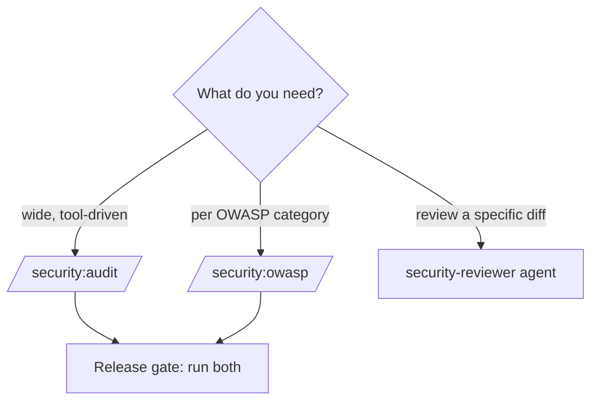

# security plugin

Read-only security review for the projects this kit is installed in. It finds weaknesses, rates
them, and tells you what to fix first. It never edits the code under review, never touches
production, and sends nothing off the machine.

## What it gives you

| Piece | Kind | Use it for |
| --- | --- | --- |
| `/security:audit [area]` | command | a broad, scanner-first sweep of the repository |
| `/security:owasp [category]` | command | a methodical pass through OWASP Top 10 (2021), A01–A10 |
| `owasp-top10` | skill | the review method, search patterns and report layout behind the OWASP pass |
| `security-reviewer` | agent | a focused reviewer you can hand a diff or a question like "is this exploitable?" |

## Which command?

- **Shipping soon and want a quick health check?** `/security:audit` — package audit, secret search,
  access-control, input, injection, config, data exposure, abuse limits, browser-side and CI checks.
  Narrow it with an area key: `deps`, `secrets`, `authz`, `config`, ...
- **Need a structured answer per OWASP category?** `/security:owasp`, optionally limited to one
  category: `A01`, `injection`, `auth`.
- **Release gate or high-risk change?** Run both; they are designed to complement each other and
  share IDs through the audit register.

## Audit register

If the project keeps findings under `docs/audits/` (or the folder set as `audit.dir` in
`.claude/toolkit.json`), each command rewrites its own report there (`security.md`, `owasp.md`) and
reconciles the open rows, following the register's own `README.md`. Without a register, reports go
to the conversation.

## How it fits with the rest of the kit

- Scope comes from `.claude/toolkit.json` (paths of enabled stacks), set up by `/core:setup`.
- Baseline rules live in this toolkit under `rules/security/` and reach projects through
  `/core:sync`; the core rules hook injects them when matching files are edited.
- `/core:judge` includes a security reviewer for per-change checks; this plugin is for wider passes.
